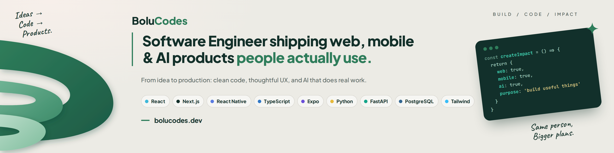

<h1 align="center">Hi 👋, I'm Onukwu Ifeanyichukwu Boluwatife</h1>
<h3 align="center">Known as BoluCodes — Software Engineer building Web, Mobile & AI-Powered Products</h3>

<!-- <p align="center">
  
</p> -->

<p align="center">
  
</p>

<p align="center">
  <a href="https://bolucodes.dev" target="_blank">
    
  </a>
  <a href="mailto:bolu.onukwu@gmail.com">
    
  </a>
  <a href="https://linkedin.com/in/ifeanyichukwu-onukwu-41b913310" target="_blank">
    
  </a>
</p>

---

### 📌 About Me

- 🎓 Computer Science student at **Caleb University**, Nigeria
- 💻 Software Engineer building **Web, Mobile & AI-powered products**
- ⚙️ Currently deepening my backend skills with **Python, FastAPI, PostgreSQL, SQLAlchemy, Redis, etc**
- 🤖 Exploring **AI Engineering** — LLMs, RAG, AI agents, and intelligent applications
- 🚀 I enjoy turning ideas into **useful, scalable software** and shipping things that actually work
- 🤝 Open to collaborating on **Web, Mobile, Backend & AI projects**
- 📈 Always learning, building, and pushing toward becoming a better engineer

> *"Code it till you own it. Design it till it speaks."*

---

### 🛠️ Tech Stack

<!-- <p align="left">
  
  &nbsp;
  
  &nbsp;
  
</p> -->


### Languages


### Frontend & Mobile


### Backend & APIs


### Databases & Services


### Tools, Cloud & Deployment


---

### 🎯 Current Focus

```text
⚙️ Backend Engineering — Python, FastAPI & scalable APIs
🤖 AI Engineering — LLMs, RAG, agents & AI workflows
🚀 Building production-ready products across Web, Mobile & AI
```

---
### 📊 GitHub Stats:

<p align="center">
  
  &nbsp;&nbsp;
  
</p>

---

### 🌐 Connect With Me

<p align="center">
  <a href="https://github.com/Boluwatife180872" target="_blank">
    
  </a>
  &nbsp;
  <a href="https://linkedin.com/in/ifeanyichukwu-onukwu-41b913310" target="_blank">
    
  </a>
  &nbsp;
  <a href="https://x.com/bolu_codes" target="_blank">
    
  </a>
  &nbsp;
  <a href="https://www.instagram.com/bolucodes/" target="_blank">
    
  </a>
</p>

---

<p align="center">
  <i>Building software that solves real problems.</i>
</p>

<p align="center">
  
</p>
